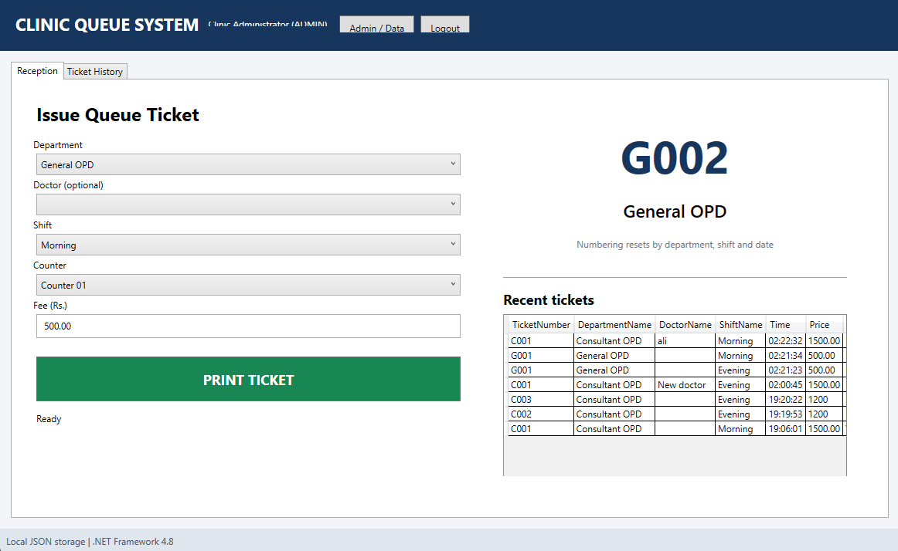
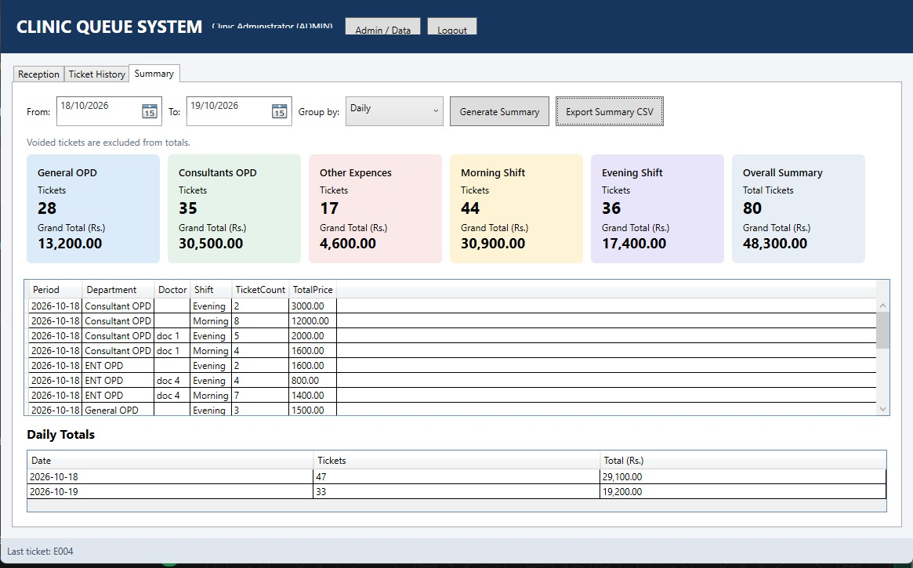

# Clinic Queue System WPF + JSON v1.2.1

A C# WPF/XAML desktop application targeting **.NET Framework 4.8**, intended for Windows 10 and Visual Studio 2026. It uses a local JSON file and does not require SQL Server, SQLite, or a database server.

## What's included in v1.2.1
- Fixed generic deletion helper compile error by constraining the generic type parameter to reference types (`where T : class`).
- Made usernames read-only in the editable user grid so edits to full name/role/status always map to the correct account.
- Added clearer JSON/master-data validation for empty records, shift time formats, printer paper widths, duplicate usernames/codes, roles, fees, and the last active administrator.
- Login cancellation now shuts down the application cleanly instead of attempting to continue with an unauthenticated main window.

## What's included in v1.2
- Full-window sign-in screen with matching dimensions to the main window and a refreshed two-panel UI.
- Exactly two account roles: `ADMIN` and `RECEPTIONIST`.
- Only ADMIN accounts see the Admin / Data button; the admin window checks the role again before opening.
- Admin CRUD screens for departments, doctors, shifts, counters, printers, and users.
- User creation and password reset with PBKDF2 password hashing; roles limited to ADMIN and RECEPTIONIST.
- Editable JSON editor in the admin window with validation before saving. The app rejects invalid JSON, duplicate department codes/usernames, invalid roles, negative fees, and removal/deactivation of the last active admin.
- Clinic name and ticket-footer settings.
- Ticket and audit-log viewing, JSON backup and restore, and open-data-folder action.
- Queue ticket history, reprint/void tracking, CSV export, and Windows printer-driver printing.
- Per-date + per-shift + per-department sequence keys (for example G001/C001/E001).

## Build with Visual Studio 2026
1. Extract the ZIP.
2. In Visual Studio Installer, make sure **.NET desktop development** and the **.NET Framework 4.8 Developer Pack/Targeting Pack** are installed.
3. Open `ClinicQueueSystem.sln`.
4. Select `Release` and `Any CPU`.
5. Choose **Build > Rebuild Solution**, or run `build.bat` from this folder.
6. Run `bin\Release\ClinicQueueSystem.exe`.

## First login
- Username: `admin`
- Password: `admin123`

Change the starter password using **Admin / Data > Users & Roles > Set password** before real clinic use. The first-run data file is created at `%APPDATA%\ClinicQueueSystem\clinic-data.json`.

## Data and safety
JSON is the primary local store because the app has related collections. CSV is used for ticket report exports. The Admin JSON editor lets an administrator edit the complete data document; malformed JSON is rejected and the previous file is preserved through the store's backup behavior. Back up data before direct edits. Do not manually edit the JSON file while the app is running.

This file-based version is suitable for one reception PC. A shared JSON file is not safe for simultaneous writes from multiple PCs; use a coordinated central service if multiple stations need a shared sequence. Thermal printer behavior must be tested with the exact Windows printer driver and printer model. Static checks in this environment confirmed that the XAML files are well-formed, the declared XAML click/selection handlers exist, and C# brace counts are balanced. This Linux environment does not have the Windows WPF/.NET Framework build tools, so the solution could not be compiled or hardware-tested here. Build and test it in Visual Studio on Windows before clinic use.

# Screenshots

